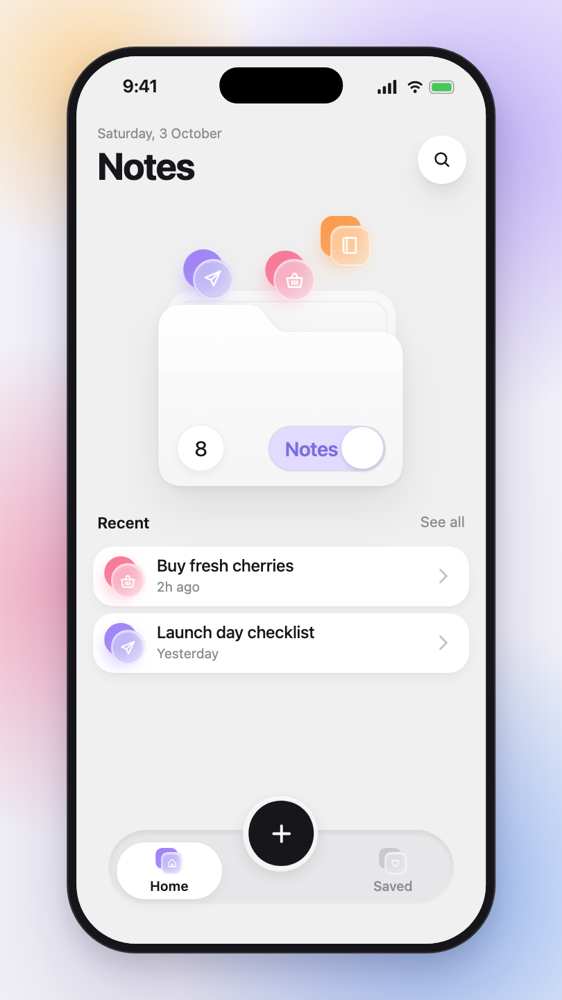
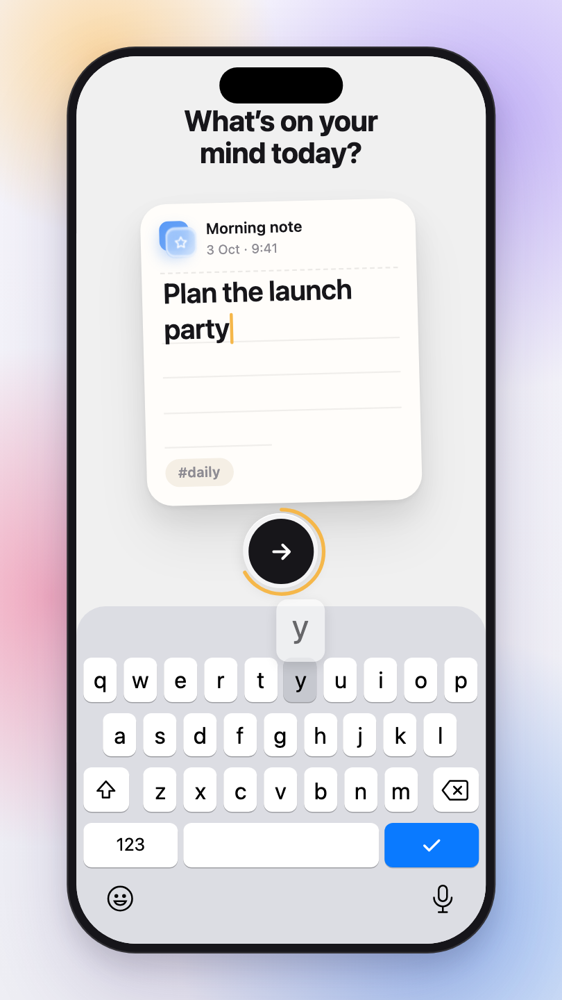
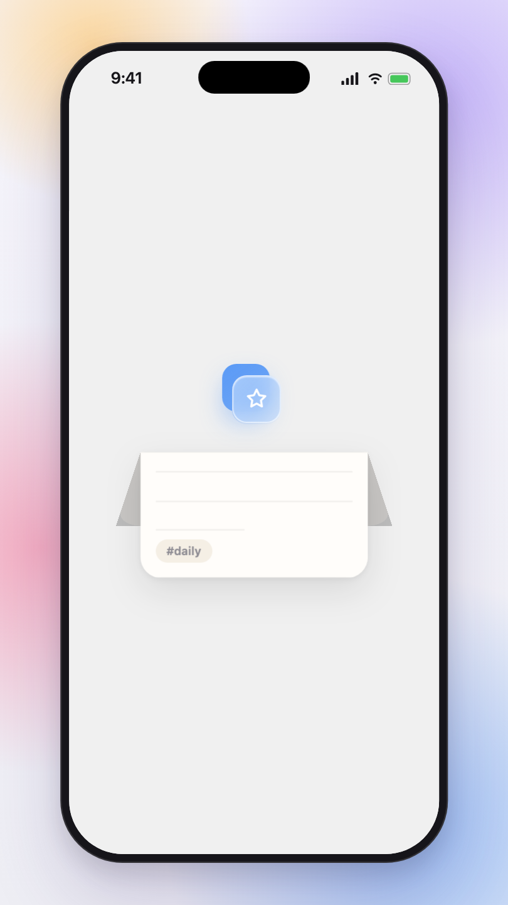
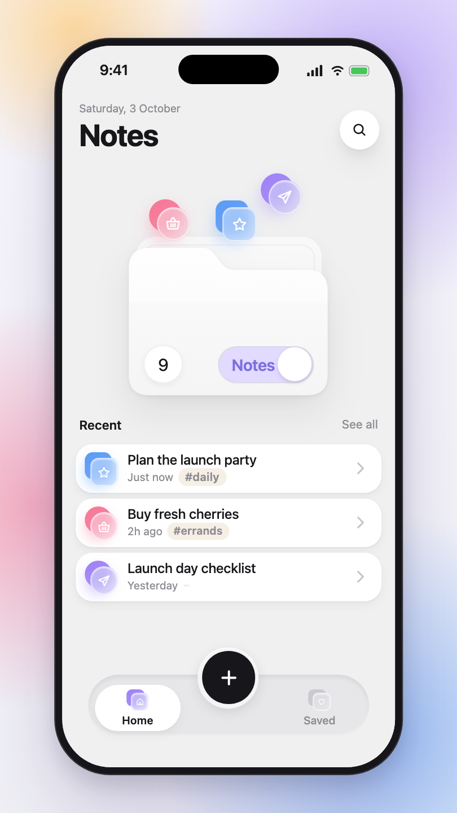
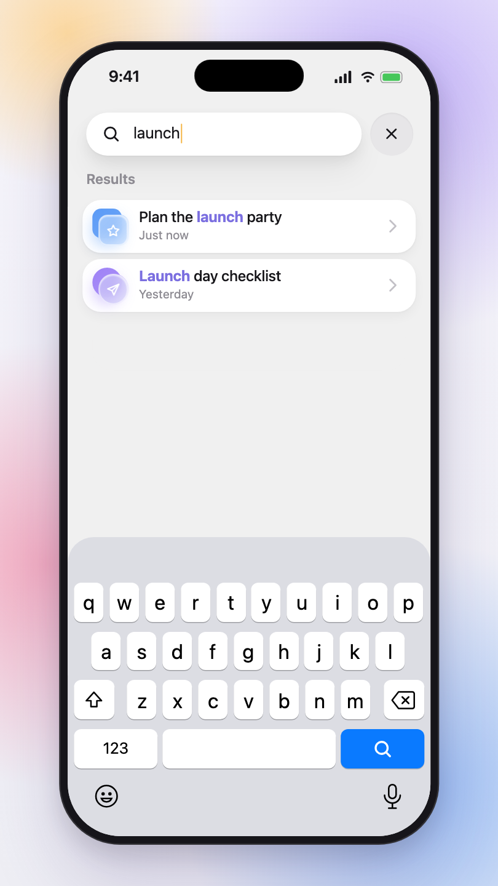
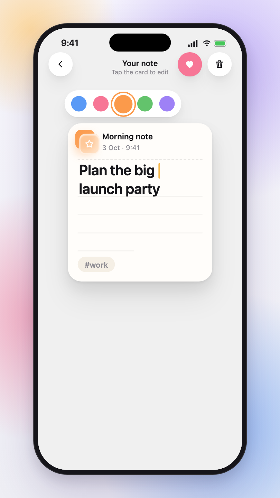

# SoftNotes — SwiftUI foundation

Home dashboard, floating tab bar and app shell recreated from the reference recording. iOS 17+, Xcode 16+, SwiftUI only, no dependencies.

## Promo

<video src="docs/promo/softnotes-promo.mp4" controls muted width="360"></video>

▶ [Watch the 20-second promo (MP4)](docs/promo/softnotes-promo.mp4) — 1080×1920, made for TikTok / Reels / Shorts. It is built with [Remotion](https://www.remotion.dev) in [`promo/`](promo/) (see [Rebuilding the promo](#rebuilding-the-promo)).

## UI mockups

<table>
  <tr>
    <td align="center"><br><sub><b>Home</b><br>folder, Recent, tab bar</sub></td>
    <td align="center"><br><sub><b>Write</b><br>paper card + keyboard</sub></td>
    <td align="center"><br><sub><b>Fold</b><br>card folds in half</sub></td>
  </tr>
  <tr>
    <td align="center"><br><sub><b>Filed</b><br>count 8 → 9, new row</sub></td>
    <td align="center"><br><sub><b>Search</b><br>live results, matches highlighted</sub></td>
    <td align="center"><br><sub><b>Edit</b><br>save, tag, icon colour</sub></td>
  </tr>
</table>

> The promo and mockups are recreated in React from the app's design tokens (`DesignSystem/Theme.swift`), not screen recordings of the simulator.

## Setup

1. `brew install xcodegen`
2. `xcodegen generate` — builds `SoftNotes.xcodeproj` from `project.yml` (the project file is git-ignored; never hand-edit it).
3. Open `SoftNotes.xcodeproj` and run on an iPhone simulator (a ~393–402 pt Pro is closest to the reference). Every view file has its own `#Preview`.
4. For frame comparisons, put the recording at `Reference/reference-walkthrough.mov` (git-ignored).

## Structure

```
App/
  SoftNotesApp.swift         @main, forces light mode
  RootContainerView.swift    shell: canvas, tabs, tab bar, compose overlay, save choreography
DesignSystem/
  Theme.swift                palette, pastel tones, metrics, springs, type
  SoftSurface.swift          layered shadows, SoftSurface, pressable style, blur transitions, idle float
  StackedIconView.swift      the two-tile glass icon
Models/
  Note.swift                 Note, NoteIcon, icon library (12), samples, relative time
  NotesStore.swift           @Observable store
Features/
  Home/                      HomeView (publishes FolderFrameKey), FolderCard, RecentNotesSection
  TabBar/FloatingTabBar.swift  tab bar + PrimaryActionButton (FAB / Next)
  Saved/SavedView.swift
  Compose/ComposeFlowView.swift  compose flow shell (nav bar, step switch, Next button)
  Compose/ComposeDraft.swift     compose state (step, icon, text)
  Compose/IconPickerStep.swift   03 Pick an icon
  Compose/WriteStep.swift        04 Write a chit
  Compose/NoteCardView.swift     the paper card (pose + single-view content)
  Compose/KeyboardOverlapPadding.swift  iOS 26 keyboard safe-area fix
  Compose/FoldTimeline.swift     05/06 phases + measured timings (ms after the Next tap)
  Compose/FoldingCardView.swift  the card as two halves; the top half folds over the centre line
  Compose/FoldStage.swift        save/fold overlay: card flight, travelling icon, fold
SoftNotesTests/                  unit tests (pixel diffs of the fold)
SoftNotesUITests/                UI tests + screenshot/video tooling (see CLAUDE.md)
scripts/                         ui-shots.sh, video-disc-track.py, video-ring-track.py, fab-morph-stats.py, promo-footage.sh
promo/                           Remotion project for the promo video + README mockups (separate npm project)
docs/                            promo MP4 and mockup PNGs used by this README
```

## Design spec (measured from the recording)

| Token | Value |
|---|---|
| Canvas | `#F0F0F0` |
| Surface (cards) | `#FFFFFF` |
| Tab track | `#E7E6E8`, inner shadow |
| Ink / FAB | `#17161A` |
| Toggle on | `#E2DAFF` bg, `#7B6FE0` text; 116 × 46 pt, 40 pt knob |
| Pastels (back tile) | pink `#F77696`, blue `#5A9AF6`, lavender `#9E81F6`, orange `#FB9A4B`, green `#63C36C`, yellow `#FFBF55`, indigo `#837AF1` (calibrated to the reference picker) |
| Note paper | `#FFFDFA`, tag chip `#F5EFE5`; card 236×258 pt, −3° at rest, ×1.2 / −1.5° while typing |
| Progress arc | amber `#F5B74A` |
| Folder | 235 × 174 pt front (25 pt tab, flat top to 0.38 of width + 27 pt curve), back panel 221 pt, chips 48 pt, count bubble 46 pt |
| Rows | 16 pt screen inset (header text at 20), radius 20, ~58 pt tall, 6 pt gap, 40 pt icon 8 pt from the edge, title 16 pt medium |
| Tab bar | 73 pt tall, 31 pt side inset, 104 pt white pill, no outline; FAB 62 pt + 5 pt canvas halo, centred on the bar's top edge |
| Header | fixed English date "Tuesday, 28 September"; 46 pt search button centred on date + title |
| Glyphs | thin outline SF Symbols (non-`.fill`), regular weight |

## Motion already wired

- **Tab switch** — white pill slides via `matchedGeometryEffect`; inactive icon desaturates; content swaps with a blur-fade.
- **FAB → Next** — the `+` morphs into the compose flow's `→` button (shared `flowNamespace`); tab track drops away, Home recedes (scale 0.94 + blur).
- **Folder** — drag to tilt in 3D (springs back), chips parallax and idle-float, toggle opens/closes the front panel on a bottom hinge.
- **Save → fold → file away (05–07)** — keyboard drops, the card flies to the centre and straightens, the icon lifts onto its top edge, nav/title/Next leave, the top half folds over the centre line; Home rises from below zoomed ×1.3 on the open folder, the folded card slides behind the front panel while the icon becomes the centre chip (count 8 → 9, chips shuffle, folder bounces), the toggle flips on, Home zooms back out and the new row slides into Recent. One timeline (`RootContainerView.save`); per-phase timings match the reference within ~100 ms. Reduce Motion replaces it with a 0.25 s cross-fade.

The reference video also has a *presentation* zoom (the whole phone, bezel included, grows ×1.14 during 06–07); that's the video editor's camera and is deliberately not built.

## Rebuilding the promo

The promo lives in [`promo/`](promo/) and is a separate npm project (the app itself still has zero dependencies).

```
cd promo
npm install
npm run audio                  # synthesises the sound effects → public/mix.wav (git-ignored)
npx remotion studio            # preview
npm run render                 # → promo/out/softnotes-promo.mp4 (copy to docs/promo/ to update the README)
node scripts/mockups.mjs       # re-render docs/mockups/*.png
```

All timing (and every sound-effect cue) comes from one file, `promo/src/timeline.ts`; `TIME_SCALE` sets the length (2 → 20 s).
